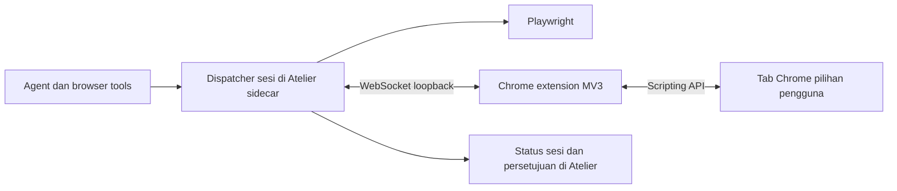

# Rencana integrasi Chrome extension untuk Atelier

## Keputusan awal

Tambahkan **Chrome Tab** sebagai mode browser opsional di Atelier Desktop. Pengguna memilih tab dari toolbar Chrome, lalu mengaitkannya ke satu sesi Atelier. Agent bisa membaca dan berinteraksi dengan tab itu menggunakan sesi login Chrome yang sudah aktif. Mode browser Playwright tetap tersedia untuk pekerjaan yang membutuhkan profil terpisah dan otomasi browser lengkap.

Di kode sekarang, `BrowserManager` menjalankan Chromium melalui Playwright, menyimpan sesi, dan mengirim frame CDP saat sesi ditonton. `BrowserView` menampilkan frame JPEG tersebut. `tools.ts` memakai `Page` dan `Locator` secara langsung, dan endpoint MCP memakai executor yang sama. Titik integrasinya ada di executor dan pengelolaan sesi browser. Extension sebaiknya menyediakan kemampuan browser yang sempit dengan kontrak sendiri, tanpa meniru seluruh API Playwright.

## Alur pengguna

1. Buka **Settings → Browser → Chrome Tab**. Atelier menampilkan panduan instalasi extension unpacked untuk pilot dan tombol **Pair Chrome**.
2. Atelier menampilkan alamat loopback dari sidecar yang aktif dan kode pairing sekali pakai. Pengguna memasukkannya di popup extension lalu melihat status **Connected** di kedua sisi.
3. Buka halaman di Chrome dan klik **Share this tab** dari toolbar extension. Di Atelier, pilih tab yang ditawarkan untuk sesi agent yang sedang dikerjakan. UI menampilkan judul, origin, dan status kontrol.
4. Agent membaca halaman dan menjalankan aksi yang didukung. Untuk login ulang, CAPTCHA, aksi sensitif, atau perpindahan origin, pengguna mengambil alih langsung di Chrome. Pengguna bisa menjeda sesi atau mencabut akses dari Atelier maupun popup.

## Cakupan MVP

| Kemampuan | Perilaku di Chrome Tab |
| --- | --- |
| Baca halaman | Snapshot teks terlihat dan elemen interaktif di frame utama, dengan batas ukuran dan referensi yang berlaku untuk dokumen saat itu. |
| Interaksi dasar | Klik, ketik ke field biasa, pilih opsi, dan scroll. Uji di halaman HTML dan SPA biasa. Input yang butuh event tepercaya, password, OTP, pembayaran, dan submit sensitif dialihkan ke pengguna. |
| Navigasi | URL HTTP(S) di origin yang sudah dibagikan dan diizinkan agent. Perubahan origin menjeda sesi sampai pengguna membagikan tab kembali. |
| Tampilan di Atelier | Status, judul, dan origin. Tab Chrome menjadi tempat pengguna melihat dan mengambil alih halaman. Screenshot atas permintaan bisa ditambahkan setelah alur dasar lolos uji, dengan pemeriksaan bahwa tab yang terlihat memang tab yang dibagikan. |
| Sesi | Satu tab untuk satu sesi aktif. Pindah fokus Chrome tidak mengalihkan target. Melepas sesi membiarkan tab pengguna tetap terbuka. |

Iframe lintas origin, popup, upload/download, screenshot full-page, login vault, live preview, dan tugas unattended masuk di luar cakupan pilot. Tool yang tidak didukung mengembalikan status yang jelas agar agent bisa berhenti atau meminta pengguna melanjutkan di Chrome. Alur QA Playwright terpisah dari pilot ini.

## Desain teknis

### Koneksi lokal dan pairing

- Untuk pilot, gunakan WebSocket khusus extension di sidecar yang sudah terikat ke `127.0.0.1`. Port desktop saat ini dinamis, jadi pairing harus menampilkan port aktual. Validasi origin `chrome-extension://` terhadap ID build yang diizinkan, sekaligus autentikasi dengan kode pairing berentropi tinggi, berumur pendek, dengan batas percobaan dan penukaran sekali pakai.
- Pairing mengeluarkan token khusus bridge yang dapat dicabut. token tidak dipakai bersama cookie atau akses API Atelier lain. Simpan token di konteks extension yang tepercaya. Sidecar menolak pairing dan perintah saat vault terkunci, serta membatalkan pairing tertunda dan melepas sesi saat lock. Untuk pilot, restart sidecar dengan port baru membutuhkan pairing ulang.
- Pakai envelope berversi dengan ID permintaan, ID sesi, identitas dokumen, jenis aksi, dan batas waktu. Validasi bentuk dan ukuran pesan di kedua ujung. Satu aksi aktif per sesi. Setelah putus koneksi pada aksi yang sudah dikirim, laporkan bahwa hasilnya belum diketahui dan baca ulang halaman setelah pengguna melanjutkan sesi. Jangan mengirim ulang aksi yang bisa mengubah halaman secara otomatis.
- Tetapkan Chrome 116 sebagai baseline pilot untuk perilaku WebSocket di service worker. Gunakan heartbeat selama sesi aktif, reconnect dengan backoff, dan minta konfirmasi share ulang bila state tab atau dokumen hilang. Evaluasi Native Messaging setelah pilot jika pairing port dinamis terlalu merepotkan untuk distribusi desktop. [Lifecycle service worker](https://developer.chrome.com/docs/extensions/develop/concepts/service-workers/lifecycle/) · [Native Messaging](https://developer.chrome.com/docs/extensions/develop/concepts/native-messaging)

### Izin tab dan kebijakan browser

- Mulai dengan `activeTab` dan `scripting` untuk akses halaman berdasarkan klik pengguna. Jalankan hanya fungsi yang dibundel extension melalui isolated world. Payload dari Atelier berisi aksi terstruktur. Tidak perlu akses semua situs, cookie, debugger, atau evaluasi JavaScript dari agent. [Izin activeTab](https://developer.chrome.com/docs/extensions/develop/concepts/activeTab/) · [Message passing](https://developer.chrome.com/docs/extensions/develop/concepts/messaging)
- Kaitkan grant ke tab, origin, sesi Atelier, dan identitas dokumen aktif. Habiskan referensi elemen saat dokumen berubah, dan validasi target masih cocok sebelum aksi. Saat tab ditutup, keluar origin, atau akses dicabut, blok eksekusi berikutnya. Validasi kebijakan host di sidecar dan periksa tab serta dokumen saat eksekusi di extension.
- Pakai kebijakan allowlist dan approval Atelier dari `policy.ts` dan `BrowserManager`. Cek ulang target setelah approval. Kalau efek klik tidak bisa diidentifikasi atau berpotensi mengirim, membayar, menghapus, atau memublikasikan, pilot mengalihkan langkah itu ke pengguna. DOM adalah data tidak tepercaya. Kecualikan nilai input sensitif, cookie, storage halaman, dan konten snapshot dari log bridge.

### Integrasi repo

1. Definisikan versi protokol dan jenis pesan di `packages/contracts`. Tambahkan mode backend dan status koneksi pada sesi browser untuk UI.
2. Tambahkan adapter Chrome Tab di `server/src/browser/` dan hubungkan route pairing ke sidecar. Di `tools.ts` buat dispatch berdasarkan mode sesi sebelum masuk jalur yang memakai objek Playwright. Jalur tool agent dan MCP memakai pemeriksaan akses sesi yang sama. Pembentukan sesi Chrome Tab memerlukan aksi eksplisit pengguna di UI.
3. Tambahkan paket extension MV3 berisi popup, service worker, dan aksi DOM yang dibundel. Putuskan jalur berbagi tab dan pairing dulu, lalu lanjutkan dari snapshot ke aksi berdasarkan referensi.
4. Tambahkan pairing ke `BrowserSettingsPanel` dan status, pause, serta takeover ke `BrowserView`. Untuk mode Chrome Tab, UI tidak berlangganan frame CDP. Putus koneksi menampilkan tombol sambung ulang tanpa memindahkan sesi diam-diam ke Playwright.

## Verifikasi dan keputusan rilis

- **Spike.** Pasangkan extension unpacked dengan build desktop Windows yang memakai port dinamis. Bagikan satu tab Chrome, tutup popup, lalu pastikan snapshot dan satu klik masih bisa dilakukan dari alur tool Atelier. Ulangi dengan restart service worker, Chrome, dan sidecar.
- **Fungsional.** Uji halaman HTML dan SPA dengan alur snapshot, klik, ketik, pilih opsi, scroll, dan takeover. Uji tab ditutup, origin berubah, referensi kedaluwarsa, approval menjadi basi, lock, unpair, dan koneksi terputus saat aksi berlangsung. Pastikan aksi tidak pindah tab atau terulang. Jalankan suite browser Atelier untuk regresi Playwright.
- **Akses.** Verifikasi origin extension yang salah, kode pairing kedaluwarsa atau dipakai ulang, token dicabut, payload tidak valid, host di luar policy, dan tidak adanya grant tab. Sertakan uji bahwa login dan tab lain tidak bocor ke snapshot atau log.
- **Performa.** Jalankan alur yang sama pada perangkat, situs, dan model yang sama. Bandingkan Playwright dengan preview aktif, Playwright dengan preview mati, dan Chrome Tab. Catat p50/p95 dari kirim tool sampai hasil, penggunaan CPU/RAM desktop dan browser, serta tingkat keberhasilan aksi dan pemulihan koneksi. Pisahkan waktu model dan waktu load situs dari waktu eksekusi tool. Jadikan hasil ini dasar keputusan apakah Chrome Tab layak jadi pilihan utama untuk pekerjaan interaktif.
- **Distribusi.** Setelah pilot, tentukan cara menetapkan ID extension stabil dan distribusi ke pengguna. Chrome Web Store dan Native Messaging memerlukan keputusan terpisah tentang rilis dan setup desktop.
